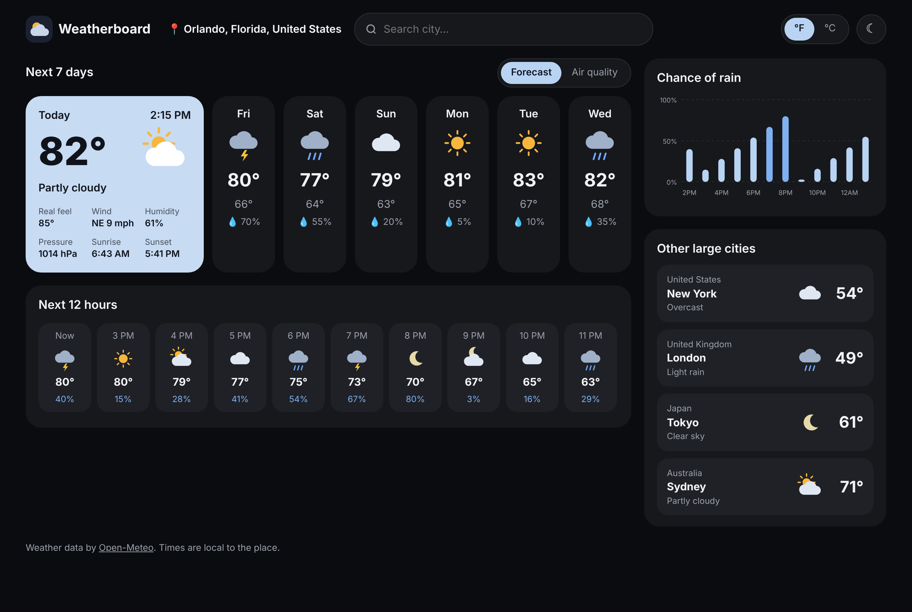
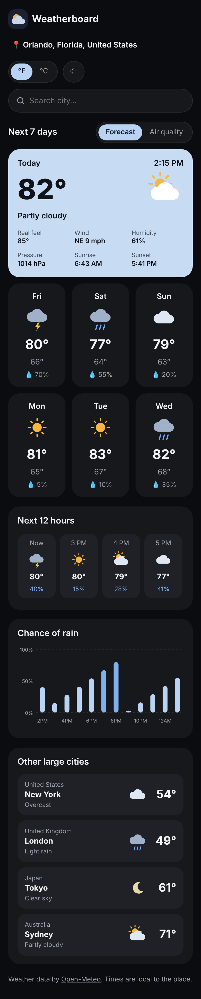
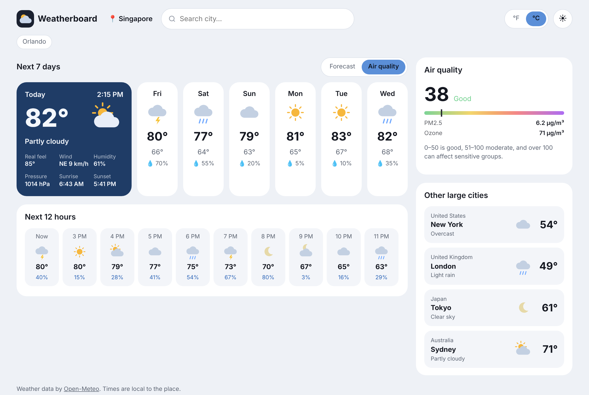

# Weatherboard

**▶ [Live demo](https://theoyanvno.github.io/weather-forecast/)**

A weather dashboard built with React: the weather now and the next 7 days for any city, the chance of rain hour by hour, the next 12 hours, air quality, and four other big cities at a glance. Search any city, switch between °F and °C or light and dark, and it remembers your choices.



| Phone | Light mode with air quality |
|---|---|
|  |  |

*Screenshots use the sample forecast in `test/fixtures.js`; the live demo shows real weather.*

## Features

- **Today:** the temperature, how it feels, the sky, wind (with direction), humidity, pressure, sunrise and sunset
- **The next 7 days:** high, low, sky and chance of rain for each day
- **Next 12 hours** and a **chance-of-rain chart** by hour, with the numbers also in a table for screen readers
- **Air quality:** the US AQI with its level (good, moderate…), PM2.5 and ozone
- **Other large cities:** New York, London, Tokyo and Sydney right now; click one for its forecast
- **City search** with suggestions as you type (arrow keys and Enter work), **recent places**, and **your location**
- **°F or °C** and **light or dark**, saved in your browser
- Works on phones, keyboard-friendly, and it says so plainly when the weather service is busy or a city isn't found

**Tech:** React 19 · JavaScript (ES modules) · CSS (grid, custom properties) · SVG (icons and the chart) · [Open-Meteo](https://open-meteo.com/) API · esbuild · `node:test`

## How it works

- **Data layer, no React** ([`src/lib/weather.js`](src/lib/weather.js)): builds the Open-Meteo URLs (one request gets now, the hours and the 7 days, in the chosen units and the place's own time zone), and turns the JSON into the shapes the page shows. Weather codes become labels and icons; wind degrees become compass points. Because it's plain functions, it's tested in Node with sample responses.
- **Fetching** ([`src/lib/cache.js`](src/lib/cache.js)): answers are cached for 10 minutes so switching back to a city is instant, failures aren't cached, and when you switch cities quickly, only the newest answer is shown (an older, slower response can't overwrite it).
- **Saved choices** ([`src/lib/prefs.js`](src/lib/prefs.js)): the city, unit and theme are saved in `localStorage`, read back carefully (bad or blocked storage falls back to the defaults).
- **Components** (`src/components/`): the today and day cards, the hourly row, the rain chart, search and the side panels. The page has a strict Content-Security-Policy: only its own script and styles, and requests only to Open-Meteo.

## Run it

```
npm install
npm start        # builds and serves at http://localhost:8000, rebuilding on every change
npm test         # node --test
npm run build    # writes the site to docs/, which GitHub Pages serves
```

| Path | What's in it |
|---|---|
| `src/App.jsx` | The page: state, loading, errors and layout |
| `src/components/` | Today and day cards, hourly row, rain chart, search, air quality, other cities, icons |
| `src/lib/` | Weather data, caching and saved choices (no React; tested) |
| `public/` | The HTML page, styles and icon copied into the build |
| `build.mjs` | Bundles the app with esbuild into `docs/` |
| `test/` | Tests and sample Open-Meteo responses |

Weather data by [Open-Meteo](https://open-meteo.com/) (free for non-commercial use, no key needed).

Built with help from AI coding tools for planning, code review and tests.

## License

MIT, see [LICENSE](LICENSE).
